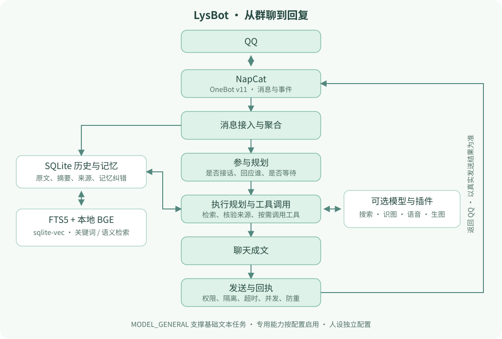

<p align="center"></p>

# LysBot · 磷叶石 Bot

## 1. 项目介绍

LysBot 是一个有长期记忆、能查资料、会接梗的 QQ 群友，默认人设是《宝石之国》的磷叶石（法斯）。它能参与日常闲聊，也能在认真讨论时检索历史、调用工具并回答问题。

- **群聊互动**：主动接话、理解引用和多人对话，支持表情包、戳一戳、复读、冷群梗图和今日人品（jrrp）。
- **记忆与检索**：记住群友的偏好、约定和事件，检索群聊原文、摘要及统计，也能查看、纠正和撤销记忆修改。
- **联网与多模态**：按需启用搜索、链接阅读、识图、语音回复、生图和参考图编辑。
- **简报与新闻**：生成每日群聊简报，并根据群内兴趣筛选新闻。
- **人设与扩展**：独立配置角色，通过插件添加工具、定时任务和通知。

日常使用和管理在 QQ 完成，部署、运维和开发交给 AI，最多自己修改 `.env`。QQ 命令见 [使用手册](docs/commands.md)。

## 2. 快速开始

### 如果你是人类

把下面这段话发给能操作电脑或服务器的 **Codex / Claude Code** 等 AI 助手：

```text
帮我部署并运行 LysBot：https://github.com/BiteTheDDDDt/LysBot
按仓库 AGENTS.md 的指引完成部署，最后验证 bot 能在 QQ 中实际回复消息。
```

准备好：

1. 一个 bot QQ 账号，首次登录时扫码确认。
2. 你自己的 QQ 号，用作 master 管理账号。
3. 一个可用的 Codex 账号，或支持工具调用的模型 API。推荐通过 CLIProxyAPI 接入 Codex 套餐。
4. 一台 AI 可以操作的电脑或服务器。

剩下的安装、配置、启动和排错交给 AI。基础聊天只需一个通用模型，无需准备 GPU 或向量数据库。

### 如果你是 AI

请从 [AGENTS.md](AGENTS.md) 开始，按其中的部署指引完成配置与验证。

## 3. 可选功能与手工配置

配置保存在 `.env`，可以自己改，也可以告诉 AI 你想启用什么。模板见 [.env.example](.env.example)，多 provider、多模型组合见 [.env.models.example](.env.models.example)。

| 配置 | 用途 |
| --- | --- |
| `MASTER_QQ`、`ACCESS_TOKEN` | 管理账号与 NapCat 连接凭据 |
| `MODEL_GENERAL`、provider 凭据 | 基础聊天及未单独配置的文本任务 |
| `MODEL_PLANNER`、`MODEL_CHAT` | 分别选行为逻辑可靠、语言风格好的强模型；未填继承 general |
| `MODEL_VISION`、`MODEL_SEARCH` | 识图与原生联网搜索，未填则关闭 |
| `MODEL_TTS`、`MODEL_IMAGE_GEN` | 语音与生图，未填则关闭；TTS 单独配置 Google |
| `ENABLE_DAILY_BRIEFING`、`ENABLE_DAILY_NEWS_BROADCAST` | 简报、新闻开关；新闻依赖简报和搜索模型 |
| `ENABLE_MODEL_CARD` | 在群名片显示回复所用模型 |
| `PERSONA_FILE` | 更换默认人设 |

每个 `MODEL_*` 都可用 ` | ` 按顺序配置多个候选，调用失败时自动往后尝试；普通文本任务还会追加 `MODEL_FALLBACK`。例如：

```dotenv
MODEL_SUMMARY="cliproxyapi:gpt-6-luna | google:gemini-3.5-flash-lite"
MODEL_FALLBACK="google:gemini-3.5-flash-lite | openrouter:nvidia/nemotron-3-ultra-550b-a55b:free"
```

完整说明：[配置与 fallback](docs/configuration.md) · [Provider 与费用](docs/providers.md) · [QQ 使用手册](docs/commands.md) · [插件扩展](docs/extensions.md)。

## 4. 原理、架构与目录

LysBot 基于 NoneBot2，通过 NapCat / OneBot v11 接入 QQ。planner 负责参与规划和工具决策，chat 负责最终表达；程序处理权限、会话隔离、并发、超时和发送回执。



群聊原文、摘要和记忆存入 SQLite，使用 FTS5 与本地 BGE / sqlite-vec 检索，再通过原文回读核验来源。人设独立配置，工具协议由程序维护。

```text
LysBot/
├── bot.py                    # 启动入口
├── src/plugins/llm_chat/     # 群聊、规划、记忆、工具和投递
├── lysbot/                  # 公共扩展 API
├── personas/                # 人设配置
├── extensions/              # 本地插件，默认不入 Git
├── scripts/                 # 部署、运维与开发工具
├── tests/                   # 隔离测试与合成评估资料
├── docs/                    # 使用、配置、部署和扩展手册
└── compose*.yaml            # Bot、NapCat 与可选模型网关
```

开发见 [贡献指南](CONTRIBUTING.md)，已有部署切换见 [迁移说明](docs/migration.md)。聊天会记录在本地，并按配置发送到模型服务，请向群友说明。

代码采用 [Apache License 2.0](LICENSE)；角色与头图相关权益见 [素材说明](assets/README.md)。
