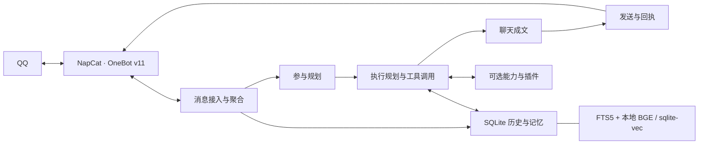

<p align="center"></p>

# LysBot · 磷叶石 Bot

## 1. 项目介绍

LysBot 是一个有长期记忆、能查资料、会接梗的 QQ 群友，默认人设是《宝石之国》的磷叶石（法斯）。它能参与日常闲聊，也能在认真讨论时查找历史、调用工具并回答问题。

- **群聊互动**：主动接话、衔接追问、理解引用和多人对话，支持表情包、戳一戳、复读、冷群梗图和今日人品（jrrp）。
- **长期记忆**：记住群友的偏好、约定和重要事件；可以询问它记得什么，并预览、确认纠正或撤销记忆修改。
- **历史检索**：从群聊原文、摘要和记忆里找线索，回读上下文、核对是谁说的，也能查询一段时间内的发言与统计。
- **联网与多模态**：按配置启用网页搜索、链接阅读、识图、语音回复、生图和参考图编辑。
- **群聊简报与新闻**：按期生成群聊简报，根据简报里的兴趣话题筛选新闻；也可以在群名片里显示当前回复使用的模型。
- **扩展能力**：通过本地插件增加工具、定时任务和外部通知，由 master QQ 账户管理。

部署、运维和开发面向 AI：人主要在 QQ 使用和管理 bot，最多编辑 `.env`；其余操作交给 AI 完成。当前首版使用 NapCat 接入 QQ。

## 2. 快速开始：直接交给 AI

把下面这段话复制给你的 **Codex / Claude Code**，或其他能操作本机、服务器的 AI 编程助手：

```text
帮我部署这个项目：https://github.com/BiteTheDDDDt/LysBot

先阅读仓库的 AGENTS.md 和 QUICKSTART.md，按文档完成环境检查、安装、
配置、启动和验证。已有配置与数据要保留，不要覆盖。
需要我填写模型凭据、提供 QQ 账号信息或扫码时再告诉我，不要回显密钥。
NapCat 的连接配置由你完成；最后确认 bot 能在 QQ 中实际收到消息并回复。
```

你需要准备一个用作 bot 的 QQ 账号、可用的模型服务，以及自己的 master QQ 号。首次登录由你用手机 QQ 扫码确认；安装依赖、准备本地向量模型、配置 NapCat 和排错都可以让 AI 处理，不需要自己进 WebUI 填连接表单。

基础聊天只需配置一个 `MODEL_GENERAL` 和对应服务凭据，无需额外部署向量数据库、embedding 服务或 GPU。默认人设已经配好，更多能力可以跑通之后再加。

具体部署步骤见 [QUICKSTART.md](QUICKSTART.md)，诊断与维护入口见 [AI 操作说明](docs/ai-operations.md)。

## 3. 可选功能与手工配置

配置集中在 `.env`，完整示例见 [.env.example](.env.example)。可以自行修改，也可以告诉 AI 你想启用什么，让它完成配置。

### 基础配置

| 配置 | 用途 |
| --- | --- |
| `MASTER_QQ` | 你的管理账号，拥有模型切换、状态查询和数据清理等权限；不是 bot 小号 |
| `MODEL_GENERAL` | 通用模型，格式为 `provider:model_id`，负责聊天、规划、摘要和记忆提取等文本任务 |
| Provider 凭据 | 对应服务的 API key；使用 OpenAI 兼容服务时还可设置 `OPENAI_BASE_URL` |
| `ACCESS_TOKEN` | bot 与 NapCat 之间的连接凭据，可以让 AI 生成并配置到两端 |

通用模型需要支持工具调用。模型可用性取决于服务商和账号权限；密钥留在本地 `.env`，不要提交到仓库。

### 专用模型与额外能力

| 配置 | 启用的能力 |
| --- | --- |
| `MODEL_VISION` | 识图、表情包识别与采集 |
| `MODEL_SEARCH` | 模型原生联网搜索 |
| `MODEL_TTS` | 语音生成与回复 |
| `MODEL_IMAGE_GEN` | 生图与参考图编辑 |

这些项**不填就没有对应能力**，不自动继承通用模型；填写时还需配置相应 provider 的凭据，并使用适配器支持的模型。读取用户提供的网页链接可以独立于 `MODEL_SEARCH` 使用。

如果需要分别控制成本和效果，可用 `MODEL_CHAT`、`MODEL_PLANNER`、`MODEL_SUMMARY`、`MODEL_IMPORTANT_INFO` 覆盖具体任务；不填时继承 `MODEL_GENERAL`。`MODEL_FALLBACK` 可配置普通文本任务的备用模型，多个候选使用 ` | ` 分隔。

### 简报、新闻与群名片

| 配置 | 功能与依赖 |
| --- | --- |
| `ENABLE_DAILY_BRIEFING=true` | 每日群聊简报，可通过 `BRIEFING_TIME` 设置时间 |
| `ENABLE_DAILY_NEWS_BROADCAST=true` | 每日新闻，依赖已开启的简报和 `MODEL_SEARCH`；时间由 `NEWS_BROADCAST_TIME` 设置 |
| `ENABLE_MODEL_CARD=true` | 在 bot 群名片中显示最近一次确认发出的文字回复所用模型 |

三项默认关闭。简报未配置生图模型时不生成群像，正文仍可正常生成。

### 人设、检索与插件

- **更换人设**：默认文件是 [personas/phosphophyllite.toml](personas/phosphophyllite.toml)，包含身份、性格、口吻、外貌和声音。让 AI 修改或复制人设文件，再通过 `PERSONA_FILE` 选择；工具协议和执行规则由程序维护。
- **本地检索**：固定使用本地 BGE 中文向量模型，由安装流程准备，日常 CPU 离线推理，不需要选型号或填维度。工件未就绪时，仍保留关键词和 SQL 查询。
- **添加插件**：把可信的本地 NoneBot 插件放进 `extensions/`，可增加模型工具、事件处理、定时任务和通知。私人插件默认被 Git 忽略，接口见 [扩展指南](docs/extensions.md)。

更多 provider、模型限制、数据路径和 QQ 命令见 [配置与运行说明](docs/configuration.md)。修改配置后的重启、验证和维护可以继续交给 AI。

## 4. 原理、架构与目录

LysBot 基于 **NoneBot2 + NapCat / OneBot v11** 接收和发送 QQ 消息。参与规划决定是否接话、回应谁或等待补充；执行规划按需检索和调用工具；聊天模型负责最后的自然表达。程序负责权限、会话隔离、超时、并发以及真实发送回执。



群聊原文、摘要和重要信息保存在 SQLite 中，后台构建全文与向量索引。模型可以先召回线索，再用只读 SQL 做精确过滤或统计，最后回读原消息核对来源。摘要和提取记忆是线索，原始发言用于核验；记忆纠错保留确认、撤销和冲突检查。

通用模型可以承担所有基础文本角色，专用模型按配置增加能力。人设从独立文件加载，工具使用、来源判断和执行约束由项目维护。

```text
LysBot/
├── bot.py                      # bot 启动入口
├── lysbot/                     # 公开扩展 API：工具注册、master 通知等
├── src/
│   ├── bootstrap.py            # 环境初始化与 master 身份映射
│   └── plugins/llm_chat/       # 群聊核心
│       ├── chat.py            # 消息处理、聚合与追问衔接
│       ├── planner.py         # 参与规划
│       ├── agent_runner.py    # 工具执行循环
│       ├── memory*.py         # 记忆存储、索引、纠错与使用记录
│       ├── retrieval.py       # 历史召回与原文回读
│       ├── history_sql.py     # 会话隔离的只读 SQL
│       └── delivery*.py       # 投递回执与防重
├── personas/                   # 默认人设及自定义角色文件
├── extensions/                 # 私人插件，默认不入 Git
├── scripts/                    # AI 诊断、NapCat 接入、维护与测试入口
├── tests/                      # 离线单元与回归测试
├── docs/                       # 配置、扩展、迁移和运维文档
├── assets/                     # 项目头图与素材说明
├── compose.yaml                # Bot、NapCat 与模型准备服务
├── Dockerfile                  # 运行镜像与依赖缓存
└── .env.example                # 配置模板
```

开发与测试见 [贡献指南](CONTRIBUTING.md)，AI 开发约定见 [AGENTS.md](AGENTS.md)，旧部署的数据与配置迁移见 [迁移说明](docs/migration.md)，已有验证及其范围见 [验证记录](docs/validation.md)。

聊天内容会写入本地数据库，并按实际配置发送给模型服务，部署者应向群友说明记录和调用方式。

代码采用 [Apache License 2.0](LICENSE)。角色名称和形象属于各自权利人，头图来源及适用范围见 [素材说明](assets/README.md)。
